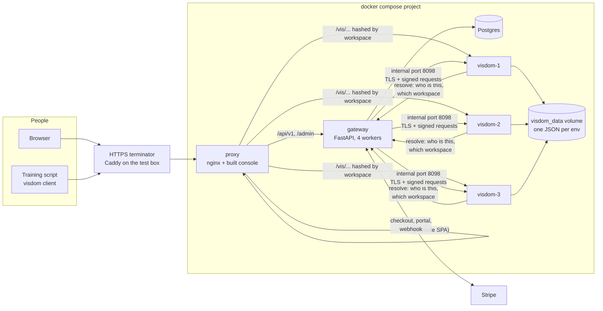
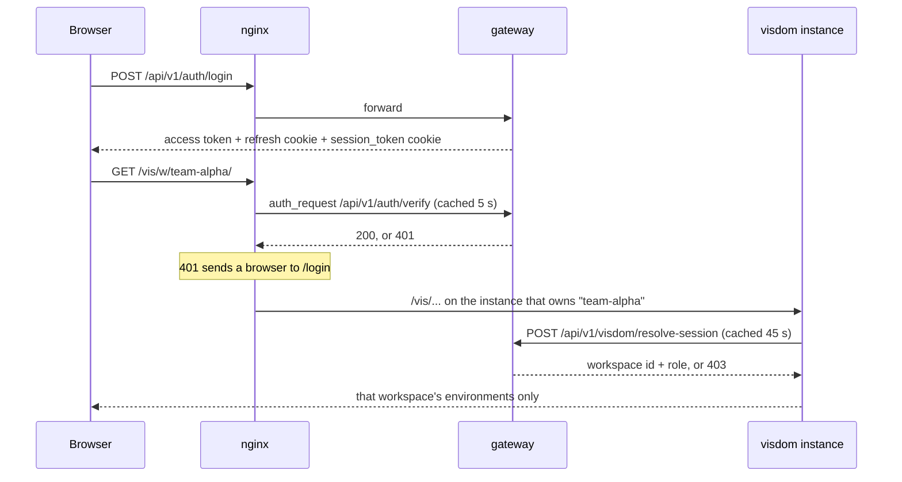
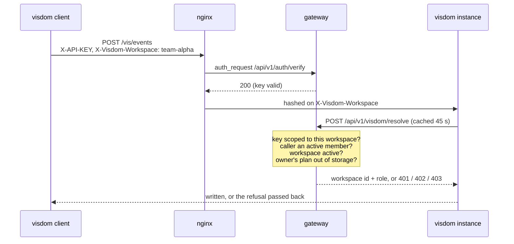
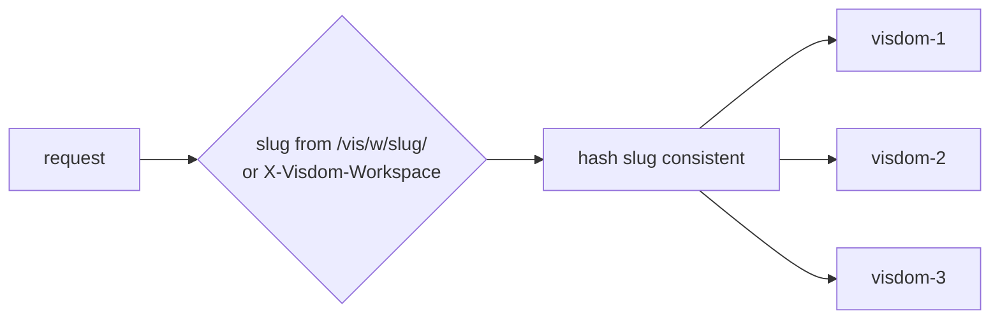
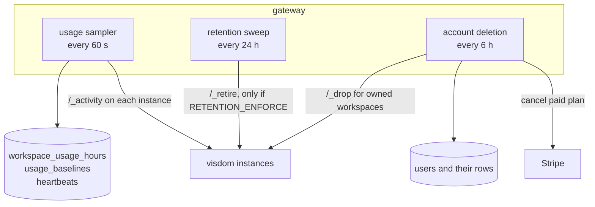
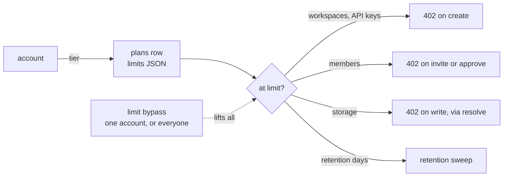
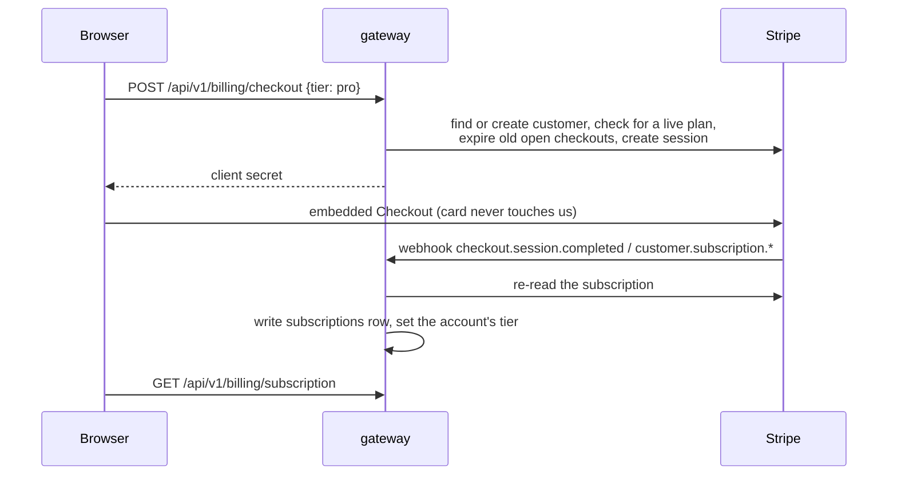
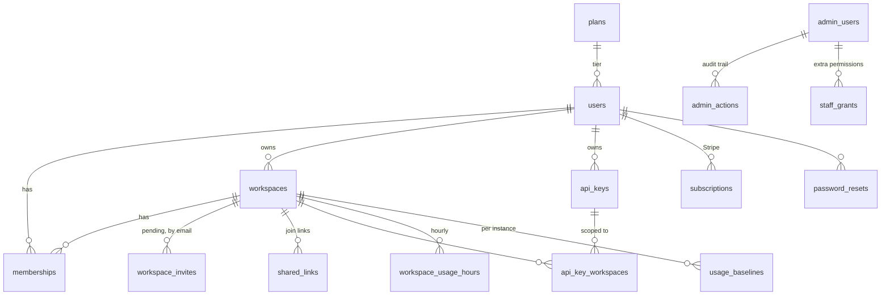

# Visdom Dev architecture

How the hosted, multi-tenant visdom fits together: what runs, who calls whom,
where data lives, and what runs in the background. Written for whoever picks
the project up next.

It describes fossasia/visdom-dev `main` plus the Stripe and limit bypass PRs
(70 and 71), and fossasia/visdom `dev`. Diagrams are Mermaid and render on
GitHub.

---

## 1. The pieces

| Piece | Code | Job |
|---|---|---|
| proxy | `deploy/proxy.Dockerfile`, `deploy/nginx.conf.template` | serves the console, routes `/api` and `/admin` to the gateway, checks every `/vis` request with the gateway, and pins each workspace to one visdom instance |
| gateway | `gateway/` | accounts, sessions, API keys, workspaces, members, invites, shared links, plans and limits, Stripe, usage metering, retention, account deletion, staff console |
| console | `frontend/` | the React app people use; talks only to the gateway |
| visdom | fossasia/visdom `dev`, `py/visdom/server/` | the plotting server, unchanged for a plain install; with `VISDOM_GATEWAY_URL` set it keeps each workspace's environments apart |
| Postgres | `gateway/app/models.py`, `gateway/alembic/` | everything except plot data |
| visdom_data | a Docker volume shared by the three instances | the plots, one JSON file per environment, one folder per workspace |

Only the proxy's port is published. The gateway, the instances and their
internal port are reachable only on the compose network. Postgres is published
on `127.0.0.1` only, for an SSH tunnel.

---

## 2. Signing in and opening plots in a browser

The console gets a short-lived access token (JWT, 15 minutes) and two cookies:
a rotating HTTP-only refresh cookie, and `session_token`, which is what nginx
and visdom look at for `/vis` requests.

- The `w/<slug>/` part of the URL is how nginx knows the workspace before
  anything is decoded. nginx strips it before passing the request on.
- Viewers are read-only in visdom for HTTP and for socket messages alike.
- A suspended workspace is refused at resolve, so new requests stop once
  visdom's 45 second cache expires. A socket that is already open is not
  closed, because it never resolves again; see Known gaps.

## 3. Writing plots from a training script

- The client needs both `api_key=` and `workspace=`. They are on visdom's `dev`
  branch, not in a release yet.
- **402** means the workspace owner's plan is out of storage. The owner's plan
  counts, not the writer's, because the owner pays.
- Storage is sampled every 60 seconds and visdom caches an allowed write for 45,
  so a workspace can go about two minutes past its limit.

## 4. One workspace, one instance

- `hash $shard_key consistent` in the nginx template. Every viewer and writer of
  a workspace lands on the same instance, so live updates reach everyone
  without the instances talking to each other.
- If an instance fails, nginx moves its workspaces to the next one and they come
  back when it recovers. The instances share one data volume, so the next one
  can load the files.
- Adding an instance moves about 1/N of workspaces. The list is
  `VISDOM_SERVERS` in `.env` and must match the `visdom-N` services.
- Measured on the 4 core ARM test box: one instance tops out at about 575 line
  writes a second on one core; three instances reached 743 and kept climbing.
  Details in `bench/README.md`.

## 5. The internal port

The gateway calls each instance on a second port, 8098, which nginx never
forwards. Everything on it is TLS with a self-signed certificate the gateway
pins, and every request carries an HMAC signature over method, path, time and
body, good for 60 seconds.

| Endpoint | Key | Used for |
|---|---|---|
| `/_activity` | read | per-workspace counters and active-minute masks, for metering |
| `/_metrics` | read (or bearer token) | Prometheus-style numbers |
| `/_evict` | admin | close a workspace's sockets; used when its owner asks to delete their account |
| `/_retire` | admin | remove environments past a retention window |
| `/_drop` | admin | remove a deleted workspace's files |

The read key cannot remove anything. Keys rotate with a `_PREVIOUS` slot, the
certificate with `deploy/internal-cert.sh`. All of it is in
`deploy/INTERNAL.md`.

---

## 6. What runs in the background

All of it runs inside the gateway, started from the FastAPI lifespan in
`gateway/app/main.py`. The gateway runs four uvicorn workers, so each loop runs
four times. The sampler and the retention sweep take a Postgres advisory lock so
only one worker does a given run; account deletion relies on each removal being
safe to repeat.

**Usage sampler** (`usage_rollup.py`). Each instance keeps counters in memory
per workspace: writes, broadcasts, bytes sent, and a 60-bit mask of the minutes
in this hour that had a write. The sampler reads every instance and folds the
result into one row per workspace per hour.

- Counters are differenced **per instance** against a stored baseline, because
  an instance restart resets them and a sum across instances would hide which
  one reset.
- Active minutes are unioned, never summed: three instances busy in the same
  minute did one minute of work.
- Stored bytes is a level, so a month is its largest reading, never a sum.
- Each run leaves a heartbeat; `/api/v1/health/components` turns 503 after five
  missed runs.

**Retention sweep** (`retention.py`). Finds environments older than the
workspace owner's plan keeps, warns `RETENTION_WARN_DAYS` ahead in the console
(a banner, and the History section of the Workspaces tab), and removes them
through `/_retire`. No email is sent about it yet. Until `RETENTION_ENFORCE=True`
it only reports. `RETENTION_STARTS` can hold off the first removals.

**Account deletion** (`account_deletion.py`). Someone asks to delete their
account; a paid plan is told not to renew and every session is signed out.
Signing in during the 30 day waiting period cancels it. After that this loop
removes the account: it refuses while the person owns a workspace others use,
cancels the Stripe subscription, drops the files of workspaces only they used,
then deletes the rows.

---

## 7. Plans, limits and payment

- Plans live in the `plans` table, so prices and limits change without a
  deploy. Every known limit must be present in a plan, because a missing one
  would read as unlimited. `None` means unlimited.
- Limits are checked **when something is created**, not as an audit. Lowering
  a limit stops new creation and leaves what exists alone.
- Limit checks lock the account row first, so two requests at the last slot
  cannot both get through.
- A superadmin can lift every limit for one account, or for everyone at once
  (PR 71). The console shows a banner while the switch for everyone is on.

Payment (PR 70):

- The webhook body is never trusted beyond its signature: the gateway re-reads
  the subscription from Stripe and writes what Stripe says.
- Changes and cancellation go through Stripe's Customer Portal.
- A failed renewal leaves the plan on `past_due` with a note in the Billing
  tab; once Stripe gives up the account drops to Free.
- Payments are off unless all three Stripe settings are set, including the
  webhook secret. Setup is in `deploy/BILLING.md`.

---

## 8. Data

Also `heartbeats` (when each background loop last finished) and
`platform_switches` (the limit bypass for everyone).

- **Memberships** carry a role (`admin`, `member`, `viewer`) and a status:
  `active`, `pending_acceptance` (invited, not yet accepted) or
  `pending_approval` (joined by link, waiting for an admin).
- **Invites to people without an account** sit in `workspace_invites` and turn
  into memberships when that email registers.
- **API keys** are stored hashed. A key is scoped to the whole account or to a
  list of workspaces.
- **Password reset tokens** are stored as SHA-256 only, last 60 minutes, and
  using one signs the account out everywhere.
- **Staff** (`admin_users`) are separate from users, with their own sign-in at
  `/admin/` and roles `viewer`, `support`, `admin`, `superadmin`. Every change
  they make goes in `admin_actions`.
- **Migrations**: Alembic, one straight chain, run on gateway start. CI
  migrates an empty Postgres to head, compares the models with the migrations,
  and reverses and replays the whole chain. The unit tests build the schema
  from the models on SQLite, so they would not notice a missing migration.

---

## 9. Where the code is

| Path | Holds |
|---|---|
| `gateway/app/main.py` | the app, routers, admin mount, background loops |
| `gateway/app/routers/` | the public API: `auth`, `workspaces`, `api_keys`, `billing`, `usage`, `health`, and `visdom` (the resolve calls) |
| `gateway/app/dependencies.py` | the current user from a token, the current key from `X-API-KEY`, sessions |
| `gateway/app/billing.py`, `usage.py`, `bypass.py` | plans, limit checks, the bypass |
| `gateway/app/payments.py` | everything that talks to Stripe |
| `gateway/app/usage_rollup.py`, `heartbeat.py` | the sampler and its heartbeat |
| `gateway/app/retention.py`, `account_deletion.py` | the two removal loops |
| `gateway/app/internal_signing.py`, `admin/activity.py` | signed calls to the internal port |
| `gateway/app/admin/` | the staff console: views, roles, permissions, audit wording, cleanup pages |
| `gateway/app/email.py` | SMTP sending, logged instead when no relay is set |
| `frontend/src/` | the console; see `frontend/README.md` |
| `deploy/` | proxy image and nginx template, internal certificate, backups, cleanup, monitoring |
| `bench/` | load generators and the capacity results |
| visdom `server/workspace_env_manager.py` | one `ServerState` per workspace, one folder per workspace on disk |
| visdom `server/workspace_manager.py` | asks the gateway to resolve a caller, with the 45 second cache |
| visdom `server/internal.py` | the internal port's endpoints and signature checks |

---

## 10. Decisions worth knowing

- **visdom asks the gateway, instead of nginx passing identity headers.** The
  original plan had nginx inject user, workspace and role headers after
  `auth_request`. Asking the gateway from visdom (cached) means a plain visdom
  install stays exactly as it was, and a socket can be checked once at open.
- **Shard by workspace, not by user.** All viewers of one workspace on one
  instance makes live fan-out free of cross-instance messaging.
- **Postgres, no time-series database.** About 24 usage rows per workspace per
  day.
- **No card data on our side.** Stripe's embedded Checkout and Portal handle
  it.
- **Separate internal port with signed requests** for the endpoints that read
  counters or remove data, so they never sit on the public port.
- **Checked at creation, never retroactively.** Lowering a limit never breaks
  an account that is already over it.

## 11. Known gaps

- Usage belongs to a workspace, not a person; per-person usage would need
  per-key reporting from visdom.
- A workspace's first minute of usage is never counted, because the first
  sighting only sets a baseline.
- The retention sweep and account deletion leave no heartbeat, so a stopped one
  does not show in the health check.
- There is no compute limit yet (active minutes per month), only storage.
- Nothing deletes accounts after long inactivity.
- Suspending a workspace does not close sockets that are already open.
- Retention warnings are shown in the console only, not emailed.
- The gateway is the one piece that does not shard. Measured at about 12
  logins a second (bcrypt) and well under one core otherwise.
